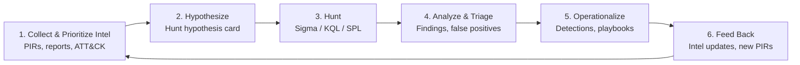

# CTI Hunt Loop Kit

**Intel-driven threat hunting, closed-loop.** A practical kit for turning cyber threat intelligence into testable hunt hypotheses, executing hunts across common SIEM/EDR platforms, and feeding what you find back into your intelligence and detection programs.

> Developed as companion material for a proposed FIRST CTI 2027 workshop and the book *Advanced Cyber Threat Intelligence and Hunting* (Dan Sorensen & Gianluca Tiepolo).

---

## Why a "loop"?

Most teams treat CTI and threat hunting as separate lanes: intel produces reports, hunters produce one-off queries, and the lessons rarely flow back. The Hunt Loop makes the hand-offs explicit so every hunt either **produces a detection**, **improves the intel**, or **retires a bad hypothesis** — and every outcome is recorded.



| Stage | Question it answers | Kit artifact |
|---|---|---|
| 1. Collect & Prioritize | What threats matter to *us* right now? | `templates/pir-worksheet.md` |
| 2. Hypothesize | What would that adversary behavior look like in our telemetry? | `templates/hypothesis-card.md` |
| 3. Hunt | Where and how do we look? | `queries/` (Sigma, KQL, SPL) |
| 4. Analyze | What did we find, and how confident are we? | `templates/hunt-report.md` |
| 5. Operationalize | How do we catch this automatically next time? | `detections/` |
| 6. Feed Back | What did we learn that changes our intel? | `templates/intel-feedback.md` |

## Repository layout

```
cti-hunt-loop-kit/
├── templates/          # PIR worksheet, hypothesis card, hunt report, intel feedback form
├── playbooks/          # ATT&CK-mapped hunt playbooks (one per technique / campaign)
├── queries/
│   ├── sigma/          # Platform-agnostic rules
│   ├── kql/            # Microsoft Sentinel / Defender XDR
│   └── spl/            # Splunk
├── detections/         # Promotion criteria for turning hunts into production detections
├── data/               # Synthetic lab dataset (Sysmon/Security JSONL + Defender/Sentinel CSV) and generator
├── workshop/           # Attendee lab guide and exercises (facilitator guide is private)
├── metrics/            # Hunt program tracker (CSV) and KPI script
├── navigator/          # ATT&CK Navigator coverage layer and coverage table (generated)
├── tools/              # Layer generator
├── tests/              # Sigma rules vs. lab answer key; repo consistency checks
├── requirements.txt    # Pinned Sigma tooling for CI, tests and the workshop (Python 3.11+)
└── CHANGELOG.md        # Release notes
```

> **Status:** v1.2. Fourteen ATT&CK-mapped playbooks covering Windows, Linux, DNS and Microsoft Entra ID, each with Sigma, KQL and SPL. Also includes a synthetic lab dataset, a full workshop, a metrics tracker and an ATT&CK Navigator coverage layer. See the roadmap below.

## Playbooks

Together, the playbooks follow a typical human-operated ransomware intrusion, from the first compromised identity in the cloud to encryption of Windows and Linux hosts. Coverage by tactic and technique is in [`navigator/COVERAGE.md`](navigator/COVERAGE.md), and there is an [ATT&CK Navigator layer](navigator/cti-hunt-loop-kit.layer.json) you can load.

| ID | Hunt | ATT&CK | Difficulty | Queries |
|---|---|---|---|---|
| [HL-0001](playbooks/HL-0001-T1059.001-encoded-powershell.md) | Encoded PowerShell & download cradles | T1059.001, T1027, T1105 | Beginner | [Sigma](queries/sigma/hl-0001_encoded_powershell.yml) · [KQL](queries/kql/hl-0001_encoded_powershell.kql) · [SPL](queries/spl/hl-0001_encoded_powershell.spl) |
| [HL-0002](playbooks/HL-0002-T1003.001-lsass-credential-dumping.md) | LSASS credential dumping | T1003.001 | Intermediate | [Sigma](queries/sigma/hl-0002_lsass_credential_dumping.yml) · [KQL](queries/kql/hl-0002_lsass_credential_dumping.kql) · [SPL](queries/spl/hl-0002_lsass_credential_dumping.spl) |
| [HL-0003](playbooks/HL-0003-T1053.005-scheduled-task-persistence.md) | Scheduled task persistence | T1053.005 | Beginner | [Sigma](queries/sigma/hl-0003_scheduled_task_persistence.yml) · [KQL](queries/kql/hl-0003_scheduled_task_persistence.kql) · [SPL](queries/spl/hl-0003_scheduled_task_persistence.spl) |
| [HL-0004](playbooks/HL-0004-T1547.001-registry-run-keys.md) | Registry Run key persistence | T1547.001, T1112 | Beginner | [Sigma](queries/sigma/hl-0004_registry_run_keys.yml) · [KQL](queries/kql/hl-0004_registry_run_keys.kql) · [SPL](queries/spl/hl-0004_registry_run_keys.spl) |
| [HL-0005](playbooks/HL-0005-T1047-T1021.002-wmi-psexec-lateral-movement.md) | WMI / PsExec lateral movement | T1047, T1021.002, T1569.002 | Intermediate | [Sigma](queries/sigma/hl-0005_wmi_psexec_lateral_movement.yml) · [KQL](queries/kql/hl-0005_wmi_psexec_lateral_movement.kql) · [SPL](queries/spl/hl-0005_wmi_psexec_lateral_movement.spl) |
| [HL-0006](playbooks/HL-0006-T1558.003-kerberoasting.md) | Kerberoasting | T1558.003 | Intermediate | [Sigma](queries/sigma/hl-0006_kerberoasting.yml) · [KQL](queries/kql/hl-0006_kerberoasting.kql) · [SPL](queries/spl/hl-0006_kerberoasting.spl) |
| [HL-0007](playbooks/HL-0007-T1490-inhibit-system-recovery.md) | Inhibit system recovery | T1490 | Beginner | [Sigma](queries/sigma/hl-0007_inhibit_system_recovery.yml) · [KQL](queries/kql/hl-0007_inhibit_system_recovery.kql) · [SPL](queries/spl/hl-0007_inhibit_system_recovery.spl) |
| [HL-0008](playbooks/HL-0008-T1218-lolbin-proxy-execution.md) | LOLBin proxy execution (mshta, regsvr32, rundll32) | T1218.005, .010, .011 | Beginner | [Sigma](queries/sigma/hl-0008_lolbin_proxy_execution.yml) · [KQL](queries/kql/hl-0008_lolbin_proxy_execution.kql) · [SPL](queries/spl/hl-0008_lolbin_proxy_execution.spl) |
| [HL-0009](playbooks/HL-0009-T1021.001-rdp-lateral-movement.md) | RDP lateral movement | T1021.001, T1078 | Intermediate | [Sigma](queries/sigma/hl-0009_rdp_lateral_movement.yml) · [KQL](queries/kql/hl-0009_rdp_lateral_movement.kql) · [SPL](queries/spl/hl-0009_rdp_lateral_movement.spl) |
| [HL-0010](playbooks/HL-0010-T1567.002-exfiltration-to-cloud-storage.md) | Exfiltration to cloud storage (rclone, MEGA) | T1567.002 | Intermediate | [Sigma](queries/sigma/hl-0010_exfiltration_to_cloud_storage.yml) · [KQL](queries/kql/hl-0010_exfiltration_to_cloud_storage.kql) · [SPL](queries/spl/hl-0010_exfiltration_to_cloud_storage.spl) |
| [HL-0011](playbooks/HL-0011-T1528-oauth-consent-abuse.md) | OAuth illicit consent grant (Entra ID) | T1528, T1550.001 | Intermediate | [Sigma](queries/sigma/hl-0011_oauth_consent_abuse.yml) · [KQL](queries/kql/hl-0011_oauth_consent_abuse.kql) · [SPL](queries/spl/hl-0011_oauth_consent_abuse.spl) |
| [HL-0012](playbooks/HL-0012-T1621-mfa-fatigue.md) | MFA fatigue / push bombing (Entra ID) | T1621, T1078.004 | Beginner | [Sigma](queries/sigma/hl-0012_mfa_fatigue.yml) · [KQL](queries/kql/hl-0012_mfa_fatigue.kql) · [SPL](queries/spl/hl-0012_mfa_fatigue.spl) |
| [HL-0013](playbooks/HL-0013-T1053.003-T1543.002-linux-cron-systemd-persistence.md) | Linux cron and systemd persistence | T1053.003, T1543.002 | Intermediate | [Sigma](queries/sigma/hl-0013_linux_cron_systemd_persistence.yml) · [KQL](queries/kql/hl-0013_linux_cron_systemd_persistence.kql) · [SPL](queries/spl/hl-0013_linux_cron_systemd_persistence.spl) |
| [HL-0014](playbooks/HL-0014-T1071.004-dns-c2-beaconing.md) | DNS C2 beaconing and tunneling | T1071.004, T1572 | Advanced | [Sigma](queries/sigma/hl-0014_dns_c2_beaconing.yml) · [KQL](queries/kql/hl-0014_dns_c2_beaconing.kql) · [SPL](queries/spl/hl-0014_dns_c2_beaconing.spl) |

ATT&CK tactic names follow ATT&CK v19 and later, where *Defense Evasion* is split into **Stealth** and **Defense Impairment**. The Navigator layer targets the current release (see [`navigator/COVERAGE.md`](navigator/COVERAGE.md)).

## Quick start

1. **Clone the repo**
   ```bash
   git clone https://github.com/NexusSecurityAdvisors/cti-hunt-loop-kit.git
   cd cti-hunt-loop-kit
   ```
2. **Pick a priority intelligence requirement (PIR)** using `templates/pir-worksheet.md`.
3. **Write a hypothesis card** (see [playbooks/](playbooks/) for a worked example) for one ATT&CK technique tied to that PIR.
4. **Run the matching query** from `queries/` against your platform, or practice first on the synthetic lab in [`data/`](data/README.md).
5. **Record the outcome** in `templates/hunt-report.md`, then complete `templates/intel-feedback.md` so the loop closes.

## Practice lab and workshop

The [`workshop/`](workshop/README.md) folder contains a 3.5-hour, hands-on lab built on a fictional ransomware intrusion, *Operation Quiet Ledger*. The intrusion starts with an MFA-fatigued Entra ID account and ends with encrypted Windows and Linux servers. The intrusion is hidden in five days of synthetic telemetry ([`data/`](data/README.md)), and benign look-alikes are planted for every hunt. You can run it in KQL (free Azure Data Explorer cluster), SPL (Splunk trial) or Sigma + Python with no SIEM at all.

```bash
python -m venv .venv && source .venv/bin/activate   # Python 3.11+
pip install -r requirements.txt
python tests/test_lab_detections.py   # every Sigma rule vs. the lab answer key
```

## Validation and CI

Every push and pull request runs the [Validate workflow](.github/workflows/validate.yml). You can run the same checks locally after `pip install -r requirements.txt`:

| Check | Command |
|---|---|
| Sigma syntax and best practices | `sigma check queries/sigma` |
| Sigma converts cleanly to Splunk | `sigma convert -t splunk --without-pipeline queries/sigma` |
| Lab dataset matches its generator | `python data/generate_lab_data.py && git diff --exit-code -- data/lab data/answer_key.json` |
| Every rule finds exactly the answer-key events | `python tests/test_lab_detections.py` |
| Playbooks, queries, answer key, README rows and links agree | `python tests/test_repo_consistency.py` |
| Metrics script runs | `python metrics/hunt_metrics.py` |
| ATT&CK Navigator layer is current | `python tools/build_navigator_layer.py --check` |

The workflow runs with read-only permissions, pins third-party actions to full commit SHAs and pins Python dependencies. [Dependabot](.github/dependabot.yml) proposes updates weekly.

## Hunt hypothesis card (preview)

```markdown
## Hypothesis ID: HL-0001
- Intel source / PIR:
- Adversary / campaign:
- ATT&CK technique(s): e.g., T1059.001 PowerShell
- Hypothesis: "If <adversary> is active in our environment, we expect to see <observable> in <data source>."
- Data sources required:
- Query reference: queries/<platform>/<file>
- Time window:
- Expected benign activity (known noise):
- Outcome: [ ] Confirmed  [ ] Refuted  [ ] Inconclusive (data gap)
- Follow-on: [ ] New detection  [ ] Intel update  [ ] Data-source gap ticket
```

## Measuring the loop

Suggested hunt program metrics. Track them in [`metrics/hunt-tracker.csv`](metrics/hunt-tracker.csv) and compute them with `python metrics/hunt_metrics.py`:

- Hunts completed per PIR
- Hypotheses confirmed / refuted / inconclusive
- Detections created from hunts
- Mean time from intel receipt to first hunt
- Data-source gaps identified and closed
- Intel products updated from hunt findings

## Roadmap

- [x] Core templates (PIR, hypothesis card, hunt report, intel feedback)
- [x] First playbook: HL-0001 encoded PowerShell and download cradles (Sigma, KQL, SPL)
- [x] Nine more ATT&CK-mapped playbooks (HL-0002 to HL-0010) with Sigma, KQL and SPL
- [x] Synthetic lab dataset and workshop exercises ([`data/`](data/README.md), [`workshop/`](workshop/README.md))
- [x] Hunt metrics tracker ([`metrics/`](metrics/README.md))
- [x] CI: every Sigma rule is tested against the lab dataset
- [x] Cloud identity hunts (OAuth consent abuse, MFA fatigue), Linux persistence and DNS C2 beaconing (HL-0011 to HL-0014), added to the lab and workshop
- [x] ATT&CK Navigator layer for kit coverage ([`navigator/`](navigator/COVERAGE.md)), regenerated and checked in CI
- [x] CI hardening: SHA-pinned actions, pinned Python tooling, Dependabot, lab reproducibility and repo consistency checks (v1.2, see [`CHANGELOG.md`](CHANGELOG.md))

## Contributing

Contributions are welcome: new playbooks, query translations, and lessons learned from running the loop in real programs.

1. Fork the repo and create a feature branch.
2. Follow the existing templates and include ATT&CK technique IDs.
3. **Never commit real customer data, IOCs under restrictive TLP, or proprietary telemetry.** Use synthetic or publicly shareable (TLP:CLEAR) material only.
4. If you add a playbook, add matching malicious and benign events to `data/generate_lab_data.py`, then regenerate so `tests/test_lab_detections.py` covers your rule. Add a row to the playbook table above and run `python tools/build_navigator_layer.py` to refresh the coverage layer.
5. Run the checks under [Validation and CI](#validation-and-ci) locally.
6. Open a pull request describing what you added and how you tested it.

## Disclaimer

This kit is provided for educational and defensive purposes. Test all queries in a non-production environment and tune them for your telemetry before operational use.

## License

Code and content are released under the [Apache License 2.0](LICENSE).

## Author

**Dan Sorensen** — Nexus Security Advisors · OWASP AI Exchange core team · Forbes Technology Council contributor
Co-author, *Advanced Cyber Threat Intelligence and Hunting* (with Gianluca Tiepolo)
